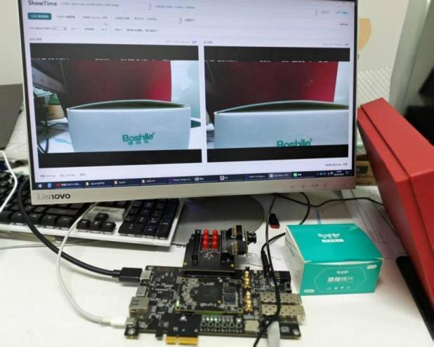
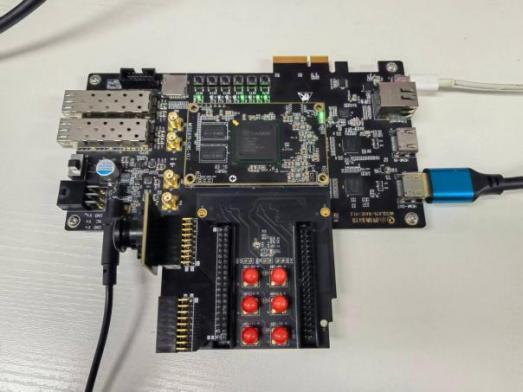
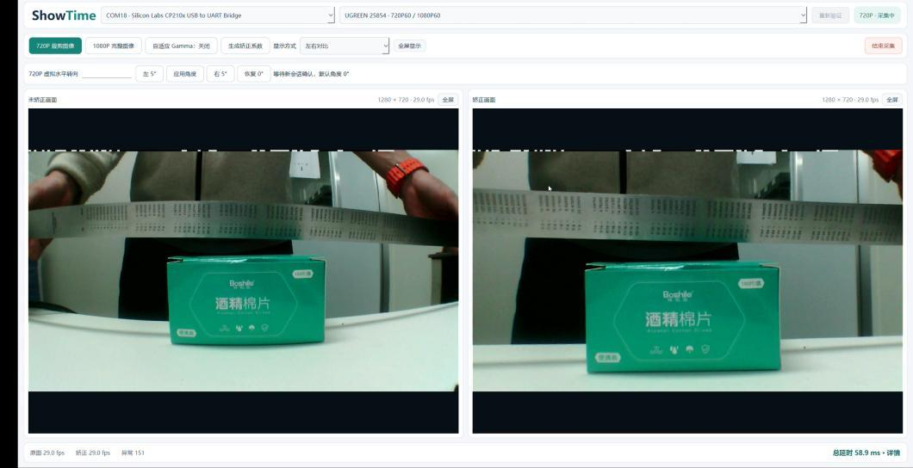
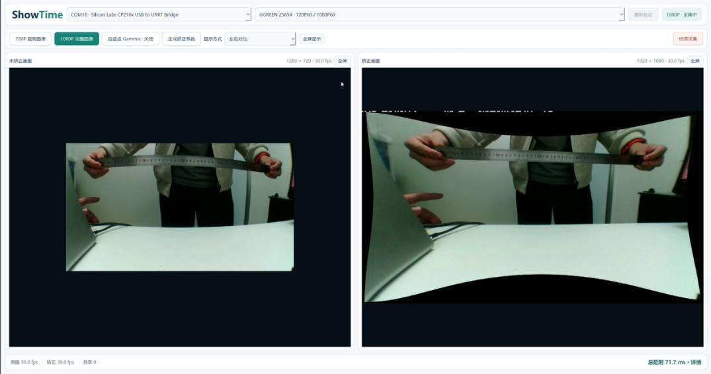
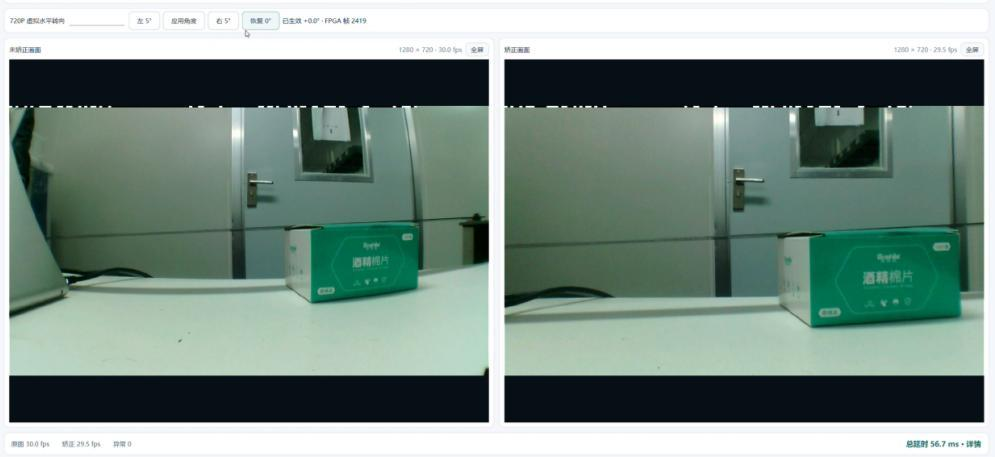
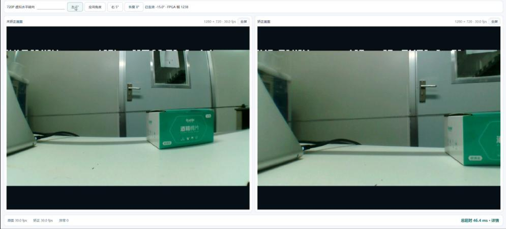
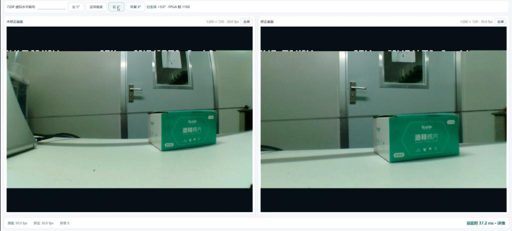
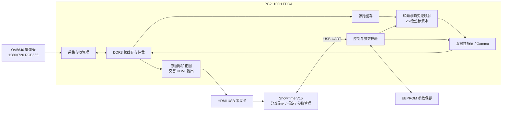

# ShowTime｜实时畸变矫正与虚拟视角控制系统

**2026 全国大学生嵌入式芯片与系统设计竞赛 · FPGA 创新设计赛道 · 紫光赛道赛题二**

**团队名称**　圣光demons　｜　**团队编号**　40831

基于紫光同创 **PG2L100H FPGA** 的实时图像处理系统：摄像头保持固定，通过硬件完成镜头畸变矫正、720P 虚拟水平转向与自适应 Gamma；ShowTime V15 上位机提供标定、参数管理和原图/矫正图对比显示。

[技术报告 PDF](docs/实时畸变矫正与虚拟视角控制系统_技术报告.pdf) · [上位机下载](https://github.com/0mzh9/ShowTime-FPGA/releases/tag/v1.0-submission) · [FPGA 位流](firmware/) · [操作说明](上位机程序/说明文档/01_使用说明.md) · [测试指标说明](docs/measurements.md)

## 实物展示



盘古 100Pro+ 开发板、FMC 扩展与 OV5640 摄像头连接到视频采集及控制链路，PC 端显示原图与矫正结果。

<details>
<summary>展开查看开发板实物</summary>



</details>

## 功能与优势

| 功能 | 实现特点 |
|---|---|
| 实时畸变矫正 | Brown–Conrady 四参数畸变模型，逆向映射与四邻域双线性插值 |
| 虚拟水平转向 | 在 720P 模式中融合转向与畸变补偿，一次映射完成联合处理 |
| 自动标定与参数保存 | 棋盘格标定、八项镜头参数手动编辑、校验与读回、EEPROM 掉电保存 |
| 帧级自适应 Gamma | 依据整帧亮度统计选择等级，在帧边界更新参数 |
| 硬件流水处理 | 列射线预计算、26 级坐标流水、112 行源缓存，125 MHz 处理时钟 |
| 对比显示与交互 | 单路 HDMI 交替传送两类图像，上位机支持左右对比、单画面及全屏 |

## 矫正与视角效果

### 720P 原图 / 矫正图



### 1080P 完整矫正画布



摄像头输入始终为 **1280×720**；1080P 指 **1920×1080 输出画布**，用于容纳完整矫正视野。以上为操作演示截图，截图中的瞬时状态与长测统计分别记录。

### 固定摄像头下的虚拟水平转向

| 0° 基准 | −15° | +9° |
|---|---|---|
|  |  |  |

[更多效果：标定与 Gamma](docs/gallery.md)

## 系统结构



FPGA 完成实时几何处理与重采样；PC 负责标定、控制及显示。HDMI 总刷新率为 60 Hz，原图和矫正图逐帧交替，两类图像各约 30 fps。

## 实测表现

以下数据来自技术报告第 3.3 节及既有测试记录，不代表重新运行本仓库后获得的新测量。

| 项目 | 结果 |
|---|---|
| 局部直线度改善 | 棋盘区域相对 RMS 直线偏差：720P 降低 **51.1%**；1080P 降低 **63.5%** |
| MTF50 初测（水平 / 垂直） | 720P：**0.209 / 0.169**；1080P：**0.250 / 0.218 cycles/pixel** |
| 矫正图平均帧率 | 720P：**29.99498 fps**；1080P：**29.99752 fps** |
| 连续运行 | 两种模式各 **1800 秒**；稳定阶段新增尺寸、标记、状态和空帧异常均为 **0** |
| 转向确认 | **59 次成功** |
| 坐标流水延迟 | 26 级、125 MHz、无停顿条件下 **208 ns** |
| 上位机延迟统计 | 既有记录平均 **46.2 ms**，为上位机分项统计口径 |
| 资源利用率 | LUT **34.28%**；FF **20.61%**；APM **45.42%**；DRM **70.32%** |
| 时序与启动 | **125 MHz 时序通过**；已完成 Flash 写入校验及断电自动启动验证 |

测量范围：直线度来自局部棋盘区域；MTF50 为斜边图像域初测。46.2 ms 不是曝光到屏幕的端到端延迟；长测存在队列旧帧丢弃，因此不表述为零丢帧。[完整口径与出处](docs/measurements.md)

## 快速使用

1. 从 [Release](https://github.com/0mzh9/ShowTime-FPGA/releases/tag/v1.0-submission) 下载便携 ZIP 并完整解压，运行 `ShowTimeV15_Portable.exe`，无需安装 Python。
2. 使用兼容板卡与固件；仓库中的位流位于 [firmware](firmware/)。下载方式按板卡与 PDS 工具配置操作。
3. 连接摄像头、开发板 HDMI 输出到 USB 采集卡，并连接板卡 USB-UART 到 PC。
4. 在上位机选择实际板卡串口及视频设备，通过连接验证后选择 720P 或 1080P 模式。
5. 使用有效镜头参数；需要重新标定时，通过棋盘样本生成参数，或手动输入参数，校验后上传保存。
6. 在 720P 模式体验虚拟水平转向，也可切换对比、单图和全屏显示。

详细说明：[上位机使用](上位机程序/说明文档/01_使用说明.md) · [通信与图像处理](上位机程序/说明文档/03_通信与图像处理说明.md)

## 仓库导航

```text
ShowTime-FPGA/
├─ FPGA_code/          PDS 工程、RTL、IP、约束与实现脚本
├─ 上位机程序/         Python 源码、使用/构建说明及第三方许可证
├─ firmware/           原工程发布的 .sbit 位流
├─ reports/            原工程时序摘要与多种子记录
├─ docs/
│  ├─ images/          技术报告中的实物与效果图
│  ├─ 实时畸变矫正与虚拟视角控制系统_技术报告.pdf
│  ├─ gallery.md       标定与 Gamma 展示
│  └─ measurements.md  测试条件与指标解释
└─ README.md
```

| 核心入口 | 位置 |
|---|---|
| FPGA 工程 | [ShowTime.pds](FPGA_code/ShowTime.pds) |
| FPGA 顶层 | [hdmi_ddr_ov5640_top.v](FPGA_code/source/rtl/hdmi_ddr_ov5640_top.v) |
| 坐标映射 | [distort_map_runtime.v](FPGA_code/source/rtl/undistort/distort_map_runtime.v) |
| 双线性插值 | [bilinear_rgb565.v](FPGA_code/source/rtl/undistort/bilinear_rgb565.v) |
| 列射线预计算 | [pan_column_table.v](FPGA_code/source/rtl/undistort/pan_column_table.v) |
| 参数保存 | [calibration_store.v](FPGA_code/source/rtl/control/calibration_store.v) |
| 上位机入口 | [viewer.py](上位机程序/源码/viewer.py) |

## FPGA 工程

使用 Pango Design Suite/Fabric Compiler **2022.2-SP6.4（build 146967）** 打开 `FPGA_code/ShowTime.pds`。
工程目标器件为 **Logos2 PG2L100H，FBG676，速度等级 -6**；顶层为 `hdmi_ddr_ov5640_top`。
保留 source、ipcore 及约束的相对位置，运行编译、综合、布局布线和位流生成。
工程中的实现参数可参阅 `FPGA_code/impl.tcl`。编程时按实际板卡与下载工具配置操作。

## 上位机源码运行

原包记录的环境为 Windows x64、Python 3.13.12，依赖版本见 requirements.txt。
在 `上位机程序/源码` 中执行：

```powershell
py -3.13 -m venv .venv
.\.venv\Scripts\python.exe -m pip install -r requirements.txt
.\.venv\Scripts\python.exe viewer.py
```

连接兼容的 FPGA 固件、USB-UART 和 HDMI USB 采集卡后，在界面选择对应串口及采集设备。
支持双模式显示、畸变矫正对比、标定参数校验与保存，以及 720P 虚拟水平转向。
详细步骤见 `上位机程序/说明文档/01_使用说明.md`。

## 离线自检

在上述源码目录运行：

```powershell
.\.venv\Scripts\python.exe bootstrap_v15.py --self-test --report ..\source_selftest.json
```

该检查不连接板卡；硬件验收仍需使用实板。

## 便携程序与验证范围

原包 EXE 超过 GitHub 普通仓库单文件限制，因此未放入源码仓库。配套便携程序 ZIP 已上传至 [Release 下载页面](https://github.com/0mzh9/ShowTime-FPGA/releases/tag/v1.0-submission)，内含原始 EXE、源码、使用说明和第三方许可证。下载 ZIP 后完整解压，运行 ShowTimeV15_Portable.exe；无需安装 Python。
本仓库由 2026-11-03 解压的新工程整理，保留源代码，移除 FPGA 编译缓存。
整理时检查了项目文件引用和 Python 语法；没有重新完成 FPGA 全流程编译或实板验证。reports 内为原包记录。

## 第三方内容

保留原包中的第三方版权和许可证声明。板卡示例、厂商 IP 及第三方库按各自授权使用；本仓库未另行授予统一开源许可证。
