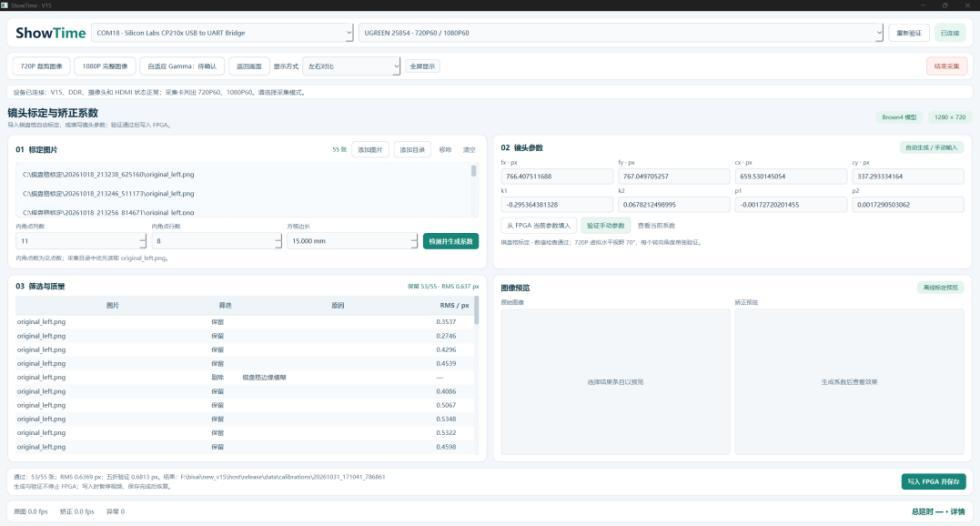
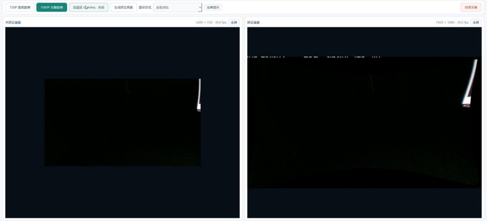
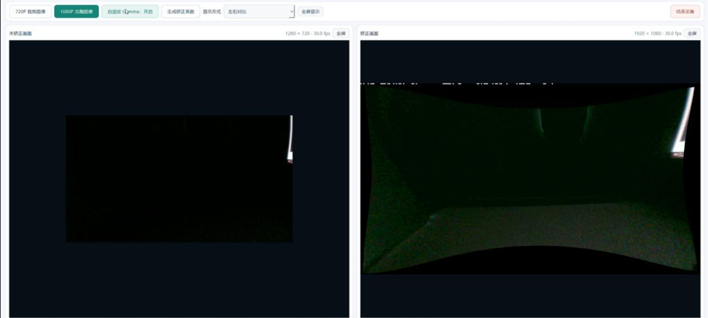

# 标定与 Gamma 展示

[返回首页](../README.md) · [技术报告](实时畸变矫正与虚拟视角控制系统_技术报告.pdf)

## 自动标定

上位机执行棋盘样本筛选与标定，支持 fx、fy、cx、cy、k1、k2、p1、p2 八项参数。板端负责参数校验、保存和运行时使用。

## 低照度自适应 Gamma

### 关闭 Gamma

### 开启 Gamma

按整帧亮度统计选档，并在帧边界更新，避免同一帧内参数改变。图片取自技术报告第 3.2 节，用于效果展示。
